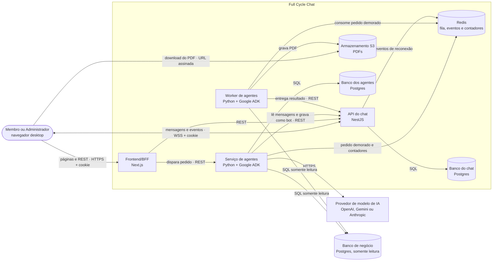
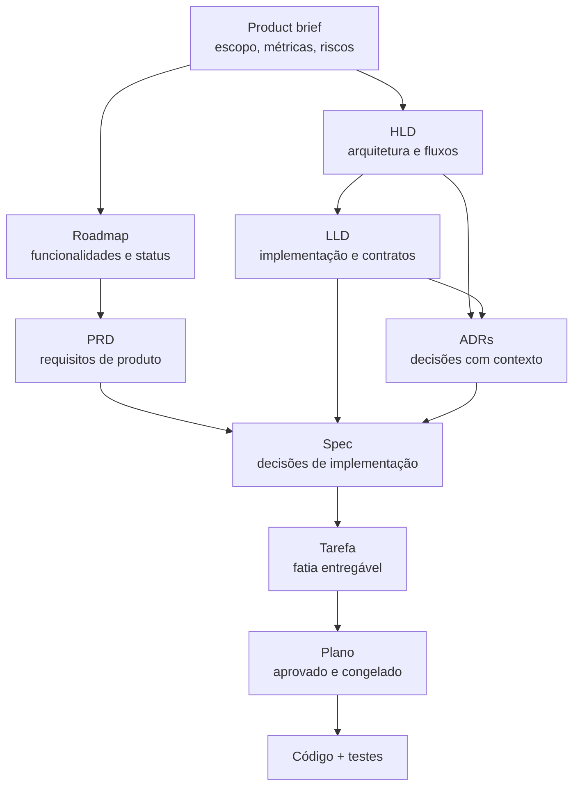

# Full Cycle Chat

Um chat de equipe no estilo Slack em que agentes de IA entram como plugins para resumir conversas,
delegar tarefas e consultar dados de negócio — e, ao mesmo tempo, um laboratório público de
**AI Engineering**: o projeto inteiro, do product brief ao código, é construído do zero com agentes
de código orquestrados por documentos, skills e comandos.

> O produto é o meio. O objetivo é compreender, na prática, como planejar, arquitetar, implementar
> e revisar um sistema real usando IA como parte do processo de engenharia.

## Índice

- [O produto](#o-produto)
- [Por que este repositório existe](#por-que-este-repositório-existe)
- [Arquitetura](#arquitetura)
- [Como os agentes funcionam no produto](#como-os-agentes-funcionam-no-produto)
- [O desenvolvimento orquestrado por IA](#o-desenvolvimento-orquestrado-por-ia)
- [Estrutura do repositório](#estrutura-do-repositório)
- [Stack](#stack)
- [Como rodar](#como-rodar)
- [Comandos e testes](#comandos-e-testes)
- [Documentação](#documentação)
- [Status do roadmap](#status-do-roadmap)

## O produto

Empresas pequenas e médias que já conversam em um chat de equipe perdem contexto no volume de
mensagens, esquecem pedidos feitos na conversa e dependem do time de dados para responder perguntas
simples sobre o negócio. O Full Cycle Chat resolve isso colocando a IA **dentro da conversa**:

- **Resumo com recorte** — "resume o que aconteceu hoje", "o que a Ana disse sobre o lançamento".
- **Delegação de tarefa** — o agente cria uma tarefa real, com responsável, notificação e
  acompanhamento em Atividade → Tarefas.
- **Consulta a dados de negócio** — contagens, somas e comparações de vendas em linguagem natural,
  com permissão por pessoa e somente leitura.
- **Relatório em PDF** — pedidos demorados rodam em segundo plano e entregam o arquivo na conversa.

Além dos agentes, o MVP entrega o chat propriamente dito: canais públicos e privados, conversas
diretas, mensagens em tempo real, menções, respostas citadas, notificações, presença, perfil e tema
claro/escuro.

O escopo completo, o público e as métricas estão no
[product brief](docs/product-brief.md). O vocabulário do domínio está no
[GLOSSARY.md](GLOSSARY.md).

## Por que este repositório existe

Este é um projeto de estudo de **AI Engineering de ponta a ponta**. A proposta não é apenas usar IA
para escrever código, mas construir um processo em que a IA participa de todas as etapas com
rastreabilidade:

1. **Produto** — o product brief define escopo, métricas e riscos.
2. **Arquitetura** — HLD e LLD registram decisões, fluxos e contratos; cada decisão relevante vira
   uma ADR.
3. **Planejamento** — o roadmap é o issue tracker; cada funcionalidade tem PRD e spec; cada spec é
   decomposta em tarefas.
4. **Execução** — cada tarefa ganha um plano aprovado e congelado antes do código, implementado com
   TDD.
5. **Revisão** — o código é revisado contra os padrões do repositório e contra a spec de origem.
6. **Memória** — `AGENTS.md` e rules guardam comandos, convenções e práticas, e os documentos de
   arquitetura apenas apontam para eles.

O resultado é um repositório em que uma pessoa (ou um agente) consegue responder "por que isto
existe?" e "o que ainda falta?" sem depender de contexto oral.

## Arquitetura

O sistema é um monorepo com aplicações implantadas separadamente. A ideia central é que **o chat
não depende dos agentes**: o BFF dispara o agente, e o agente devolve o resultado à conversa como um
bot, pela mesma API que as pessoas usam.



Decisões estruturais já registradas em ADR:

| Decisão | ADR |
| --- | --- |
| Monorepo com três aplicações: BFF, chat e agentes | [0001](docs/adr/0001-monorepo-tres-aplicacoes.md) |
| Next.js como BFF e WebSocket direto na API do chat | [0002](docs/adr/0002-next-bff-websocket-direto.md) |
| Agentes em Python com Google ADK | [0003](docs/adr/0003-agentes-python-google-adk.md) |
| Worker separado para pedidos demorados | [0006](docs/adr/0006-worker-separado.md) |
| O BFF dispara o agente e o agente grava como bot | [0009](docs/adr/0009-bff-dispara-agente.md) / [0010](docs/adr/0010-agente-grava-como-bot.md) |
| Somente leitura no banco e no código | [0013](docs/adr/0013-somente-leitura-banco-e-codigo.md) |
| Lastro de cada número conferido antes de gravar | [0014](docs/adr/0014-lastro-antes-de-gravar.md) |
| Dados de negócio emitidos pessoa a pessoa no WebSocket | [0020](docs/adr/0020-dados-de-negocio-pessoa-a-pessoa.md) |

O desenho completo está no [HLD](docs/hld.md); o detalhamento de implementação, no
[LLD](docs/lld.md).

## Como os agentes funcionam no produto

O agente é um **plugin conectado ao workspace**, não uma parte do núcleo do chat. O administrador
conecta e desconecta agentes; os demais membros apenas os veem e sabem a quem pedir.

### Pedido comum

1. A pessoa menciona o agente em um canal ou conversa direta.
2. O BFF grava a mensagem na API do chat, que emite um **identificador de pedido**.
3. O BFF consulta o registro de agentes e dispara o Serviço de agentes, sem esperar a resposta.
4. O Serviço confere limite de pedidos e teto de custo, lê pela API as mensagens de que precisa,
   chama o modelo e grava a resposta na conversa como bot.
5. A API publica a mensagem pelo WebSocket para todos os membros.

A mesma conversa suporta follow-up: quando o agente faz uma pergunta, a próxima mensagem daquela
pessoa vai para o agente **sem nova menção**, e os botões de resposta pronta viram mensagens comuns.

### Segurança e confiança

- **Permissão por pessoa** — o BFF envia identidade e permissões no pedido; sem permissão de dados,
  o agente recusa sem consultar o banco.
- **Somente leitura em duas camadas** — a consulta é validada no código e executada por um usuário
  do Postgres que só lê o Banco de negócio.
- **Lastro de cada número** — antes de gravar, o agente confere que todo número citado aparece no
  resultado da consulta. Na dúvida, diz que não conseguiu; nunca inventa.
- **Conteúdo bloqueado** — mensagens marcadas como "dados de negócio" são emitidas pessoa a pessoa:
  quem tem permissão recebe o conteúdo, os demais veem a mensagem bloqueada.
- **Auditoria** — cada consulta registra quem pediu, a conversa, a pergunta, a consulta e o
  desfecho, sem o conteúdo do resultado.
- **Chat resiliente** — se o modelo ou o serviço de agentes falhar, a mensagem já está gravada e
  quem pediu vê o erro. Nunca existe resposta simulada.
- **Modelo trocável** — OpenAI, Gemini ou Anthropic por configuração, sem mudar código.

### Pedidos demorados

Relatórios em PDF saem do caminho síncrono: o Serviço de agentes valida a consulta, enfileira o
pedido no Redis, avisa na conversa que começou, e o Worker executa a consulta, confere o lastro,
gera o PDF no S3 e entrega o resultado. O download usa URL assinada de validade curta, concedida só
a quem tem permissão.

## O desenvolvimento orquestrado por IA

Esta é a parte central do experimento: **como organizar um projeto para que agentes de código
produzam trabalho confiável**. A estrutura não é um conjunto de prompts soltos; é um sistema de
memória, planejamento e verificação.



### Memória do projeto

- [`AGENTS.md`](AGENTS.md), na raiz, define o produto, o ambiente Docker, o planejamento, as
  convenções de Git e as regras de uso das skills.
- `apps/chat-api/AGENTS.md` e `apps/web/AGENTS.md` guardam comandos, particularidades da stack e
  práticas de código de cada aplicação.
- [`.opencode/rules/`](.opencode/rules/) contém regras por tipo de arquivo (controllers, services,
  erros, testes, padrões de código), carregadas automaticamente pelo [`opencode.json`](opencode.json).
- [`skills-lock.json`](skills-lock.json) fixa a versão das skills externas usadas pelo agente.

A regra editorial é: **cada informação tem um dono só**. O produto mora em `docs/`, as práticas
moram em `AGENTS.md` e rules, e um documento aponta para o outro em vez de repetir.

### Comandos que orquestram o ciclo

Os comandos em [`.opencode/command/`](.opencode/command/) materializam o fluxo:

| Comando | Papel |
| --- | --- |
| `/prd` | Cria ou revisa o PRD de uma funcionalidade e atualiza o status no roadmap |
| `/to-spec` | Entrevista o usuário, escreve a spec técnica e decompõe a funcionalidade em tarefas |
| `/plan-task` | Planeja uma tarefa: critérios, contrato de rotas/eventos/tabelas e como cada critério será provado |
| `/implement` | Implementa a tarefa com TDD, commit, code review, conferência e verificação completa |
| `/hld` | Gera ou revisa a arquitetura de alto nível |
| `/lld` | Gera ou revisa a arquitetura de baixo nível |
| `/to-tasks` | Quebra um plano, spec ou conversa em tarefas tracer bullet com bloqueios explícitos |

### Skills que dão capacidade ao agente

O projeto carrega skills especializadas conforme a tarefa:

- **tdd** — construir test-first, com testes de integração e ponta a ponta.
- **code-review** — revisão em dois eixos: padrões do repositório e aderência à spec.
- **grilling / grill-with-docs** — entrevista implacável para amadurecer planos e decisões, criando
  ADRs e glossário no caminho.
- **domain-modeling** — manutenção do vocabulário e do modelo de domínio.
- **nestjs-best-practices**, **next-best-practices**, **vercel-react-best-practices** — padrões das
  stacks.
- **playwright-cli** — automação de navegador e validação visual.

### Rituais de engenharia

- **Tarefa = fatia vertical** — cada tarefa atravessa schema, API, interface e testes e pode ser
  demonstrada sozinha.
- **Plano congelado** — antes do código, o plano é aprovado e commitado. Depois disso ele não muda:
  uma decisão errada é corrigida na spec, no LLD ou em uma tarefa nova.
- **TDD** — a implementação começa pelos testes previstos no plano, com banco real nas suítes de
  integração e ponta a ponta.
- **Revisão dupla** — o agente revisa o próprio trabalho contra os padrões e contra a spec, e o
  merge continua sendo decisão humana.
- **Verificação completa** — lint, typecheck, testes de unidade, integração, ponta a ponta e build,
  sempre dentro dos contêineres.
- **Documentação viva** — quando uma tarefa muda algo que o HLD ou o LLD registra, a atualização
  entra no commit de plano, antes de o código existir.
- **Contexto externo** — bibliotecas e APIs são consultadas no Context7 para evitar conhecimento
  desatualizado.

### Por que tudo roda em Docker

Nenhum comando de projeto roda direto na máquina: `pnpm`, `node` e `npx` sempre executam nos
contêineres do Compose. Isso garante versões idênticas para pessoas e agentes e evita que o agente
"funcione só na máquina de quem escreveu".

## Estrutura do repositório

```
apps/
  web/            Frontend/BFF em Next.js (App Router)
  chat-api/       API do chat em NestJS: REST, WebSocket e comando de contas
  agents/         Serviço de agentes e Worker em Python + Google ADK (planejado)
packages/
  chat-events/    Tipos dos eventos do WebSocket compartilhados (planejado)
docs/
  product-brief.md    O que é o produto, para quem, escopo e métricas
  hld.md              Arquitetura de alto nível
  lld.md              Arquitetura de baixo nível
  design-system.md    Linguagem visual, tokens e componentes
  roadmap.md          Funcionalidades, dependências e status
  adr/                Architectural Decision Records
  funcionalidades/    PRDs, specs, tarefas e planos
docker/
  postgres/init/      Criação dos bancos chat, agents e business
.opencode/
  command/            Comandos do fluxo de trabalho com IA
  rules/              Regras por tipo de arquivo
compose.yaml        Ambiente local completo
```

## Stack

| Camada | Tecnologia |
| --- | --- |
| Frontend/BFF | Next.js 16 (App Router), React 19, TypeScript, Tailwind CSS 4, Radix UI |
| API do chat | NestJS 12, TypeORM, class-validator, Argon2id, Vitest |
| Tempo real | Socket.IO |
| Agentes | Python + Google ADK, FastAPI, modelo trocável (OpenAI/Gemini/Anthropic) |
| Banco | PostgreSQL 18 (bancos `chat`, `agents` e `business` na mesma instância) |
| Fila e contadores | Redis gerenciado |
| Arquivos | Armazenamento compatível com S3 |
| Infra local | Docker Compose (Node 26, pnpm 11, SeaweedFS) |
| Testes da web | Playwright no Chromium, com `@axe-core/playwright` |

## Como rodar

Pré-requisitos: Docker e Docker Compose.

```bash
# 1. Sobe os contêineres e espera Postgres e S3 ficarem prontos
docker compose -f compose.yaml up -d --build --wait

# 2. Acompanhe a instalação das dependências (só na primeira subida)
docker compose -f compose.yaml logs -f web
docker compose -f compose.yaml logs -f chat-api
```

Os contêineres `web` e `chat-api` instalam as dependências e ficam parados; a aplicação sobe na mão:

```bash
# Terminal 3 — API em http://localhost:3001
docker compose -f compose.yaml exec chat-api pnpm start:dev

# Terminal 4 — Web em http://localhost:3000
docker compose -f compose.yaml exec web pnpm dev --hostname 0.0.0.0
```

As migrações **não** rodam na subida. Para aplicá-las:

```bash
docker compose -f compose.yaml exec chat-api pnpm migration:run
```

Para derrubar o ambiente:

```bash
docker compose -f compose.yaml down
```

Para recomeçar do zero, apagando os dados:

```bash
docker compose -f compose.yaml down -v
```

| Serviço | Endereço na máquina |
| --- | --- |
| Web | `http://localhost:3000` |
| API do chat | `http://localhost:3001` |
| PostgreSQL | `localhost:5432` |
| S3 (SeaweedFS) | `http://localhost:8333` |

## Comandos e testes

Todos os comandos rodam nos contêineres, a partir da raiz:

```bash
docker compose -f compose.yaml exec chat-api <comando>
docker compose -f compose.yaml exec web <comando>
```

### API do chat

| Comando | O que faz |
| --- | --- |
| `pnpm start:dev` | Sobe a API em modo watch |
| `pnpm test` | Testes de unidade (`*.spec.ts`) |
| `pnpm test:int` | Testes de integração (`*.int-spec.ts`) |
| `pnpm test:e2e` | Testes de ponta a ponta (`test/*.e2e-spec.ts`) |
| `pnpm lint` | Oxlint |
| `pnpm exec tsc --noEmit` | Checagem de tipos |
| `pnpm build` | Compila para `dist/` |
| `pnpm migration:generate migrations/<Nome>` | Gera migração a partir das entidades |
| `pnpm migration:run` | Aplica migrações pendentes |
| `pnpm accounts <operação>` | Cria Pessoa, revoga Sessões, redefine senha e limpa Sessões vencidas |

### Web

| Comando | O que faz |
| --- | --- |
| `pnpm dev --hostname 0.0.0.0` | Sobe o servidor de desenvolvimento |
| `pnpm lint` | ESLint com `eslint-config-next` |
| `pnpm exec tsc --noEmit` | Checagem de tipos |
| `pnpm build` | Compila para produção |

A verificação completa de cada projeto está no `AGENTS.md` dele.

## Documentação

Os documentos são a fonte de verdade do projeto e formam uma cadeia rastreável:

| Documento | O que responde |
| --- | --- |
| [Product brief](docs/product-brief.md) | O que o produto é, para quem, escopo do MVP, métricas e riscos |
| [HLD](docs/hld.md) | Contexto, restrições, requisitos de qualidade, contêineres, fluxos e implantação |
| [LLD](docs/lld.md) | Estrutura do código, dados, interfaces, estados, configuração e ambiente local |
| [ADRs](docs/adr/) | Cada decisão relevante, com contexto, decisão e consequências |
| [Roadmap](docs/roadmap.md) | Funcionalidades, ordem, dependências e status |
| [Design system](docs/design-system.md) | Tokens, componentes, estados e fluxo com o Figma |
| [Glossário](GLOSSARY.md) | O vocabulário do domínio, com termos a evitar |
| [Funcionalidades](docs/funcionalidades/) | PRDs, specs, tarefas e planos aprovados |

O design de referência está no [Figma](https://www.figma.com/design/plW17JDOoRHydUJIIi2u87/slack).

## Status do roadmap

O MVP tem 12 funcionalidades na Fase 1 e mais 7 na Fase 2. O estado detalhado fica no
[roadmap](docs/roadmap.md); hoje:

- **F01 — Entrar e sair:** em andamento. Os tokens e a fundação de UI, os componentes, a verificação
  e saída da sessão e o comando de contas já foram entregues; restam o cliente de sessão no BFF, a
  porta de sessão com layout autenticado, a tela de entrar, a home com menu da pessoa e os testes
  de ponta a ponta.
- **F02 a F12:** planejadas.
- **F13 a F19 (Fase 2):** planejadas, e só começam quando a Fase 1 atingir as metas de qualidade.

## Licença

Sem licença definida até o momento.
