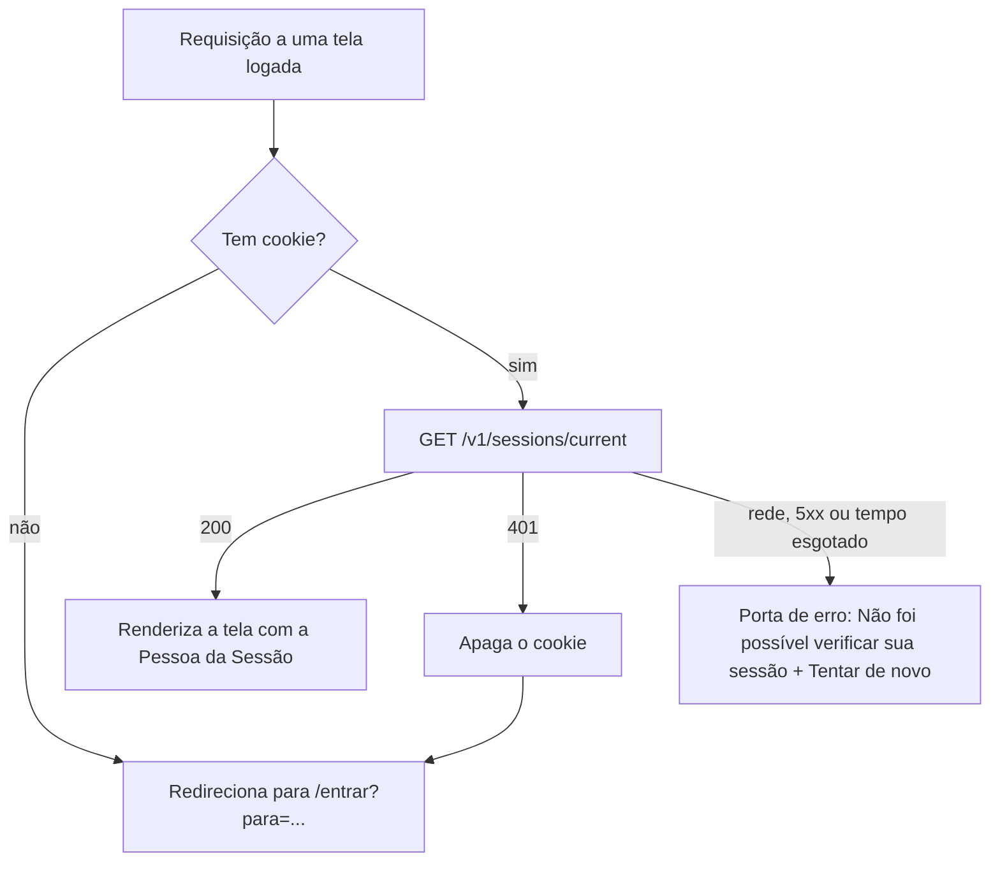

# F01 — Entrar e sair — Spec

Status: rascunho

- **Funcionalidade:** F01
- **PRD:** [prd.md](prd.md)
- **Roadmap:** [roadmap](../../roadmap.md)
- **HLD:** [hld.md](../../hld.md)
- **LLD:** [lld.md](../../lld.md)
- **Design system:** [design-system.md](../../design-system.md)
- **Glossário:** [GLOSSARY.md](../../../GLOSSARY.md)

> **Vocabulário.** O PRD usa "conta" para a Pessoa e para o registro criado fora do produto. O
> [`GLOSSARY.md`](../../../GLOSSARY.md) pede **Pessoa** e evita "conta". Esta spec usa **Pessoa**
> para quem entra e "conta" só para o registro e a credencial criados pela empresa, fora do
> produto.

## 1. Objetivo técnico

Fechar a F01 ponta a ponta: a API do chat passa a verificar, renovar e encerrar Sessões; o BFF
guarda o token num cookie httpOnly e leva a Sessão à API; a web entrega a tela de entrar, a Home
vazia, o menu da Pessoa com Sair e as portas de sessão; e o comando de contas cria Pessoas, revoga
Sessões, redefine a senha e limpa Sessões vencidas.

O `POST /v1/sessions` já existe na branch `feature/login`, com o limite de tentativas da
[ADR 0023](../../adr/0023-limite-de-login-por-email.md). Esta funcionalidade preserva esse
comportamento e constrói o restante. Os requisitos de produto estão no [PRD](prd.md); esta spec
não os repete.

## 2. Decisões de implementação

1. **A Sessão continua na API do chat.** A API é dona do token, valida cada requisição REST e
   revoga apagando a linha; o BFF só carrega e repassa o token no cookie
   ([ADR 0016](../../adr/0016-sessao-na-api-do-chat.md); HLD 6.1).
2. **Verificar, renovar e sair seguem o LLD 6.2.** O `GET /v1/sessions/current` confere o token,
   apaga a Sessão vencida ao apresentá-la e renova `expires_at` só quando passou o intervalo de
   renovação desde `last_used_at`. O `DELETE /v1/sessions/current` apaga só a Sessão apresentada.
   A `Duração da Sessão` vem de `SESSION_TTL_DAYS` e o intervalo de renovação é a constante de 1
   dia (LLD, seção 9). A renovação é um `UPDATE` condicional, para duas abas não escreverem duas
   vezes.
3. **`AuthGuard` e `UnauthenticatedError` entram agora.** O guard lê o cookie de Sessão do
   cabeçalho `Cookie`, chama o service e anexa a Sessão autenticada ao request; token ausente,
   desconhecido ou vencido lança `unauthenticated`, sem distinguir os casos. O erro é de domínio e
   só o filter monta o 401, como pede
   [`.opencode/rules/nest-api-errors.md`](../../../.opencode/rules/nest-api-errors.md), que já cita
   esse guard e esse erro como exemplo.
4. **O cookie é do BFF, mas a API precisa do nome dele.** O BFF grava, repassa e apaga o cookie
   com `HttpOnly`, `Secure`, `SameSite=Lax`, `Path=/` e `Max-Age` de 400 dias; o `Domain` vem de
   variável (LLD, seção 3 e seção 9). A API lê o token do mesmo cookie, então as duas pontas
   precisam do mesmo nome. As duas leem `SESSION_COOKIE_NAME`, com o padrão `session`, e o nome
   está no LLD, seção 9 (questão em aberto 1 resolvida).
5. **O BFF traduz o erro da API em resultado de Server Action.** O navegador não recebe
   `application/problem+json` do BFF: a ação devolve um resultado discriminado
   (`invalid_credentials`, `too_many_attempts` com os segundos do `Retry-After`,
   `validation_error` ou `unavailable`) e a tela usa o microtexto do Figma. O LLD deixa "quem
   traduz" em aberto no BFF; esta spec fixa a tradução para as ações de Sessão.
6. **A verificação é feita uma vez por requisição.** O `AuthGuard` na API e a função de
   verificação no BFF são reaproveitados pelo layout e pela página com o `cache()` do React, para
   não renovar a Sessão duas vezes no mesmo render.
7. **Voltar para onde ia segue o LLD, seção 8.** O `?para=` só vale como caminho relativo que
   começa com `/` e não com `//`; sem ele, ou com outro valor, a Pessoa vai para a Home. A
   validação acontece no servidor, não só no formulário.
8. **O comando de contas é a via de operação da F01.** O HLD, seção 2, cria contas fora do
   produto, e o LLD, seções 6.2 e 7, usa o comando para revogar, redefinir a senha e limpar
   Sessões vencidas. Esta funcionalidade entrega as operações de login (criar Pessoa, revogar
   Sessões, redefinir a senha e limpar Sessões vencidas); papéis e permissões ficam em F08 e F14.
9. **A interface segue o design system.** Tokens, tipografia, raios, elevação e componentes saem
   de `docs/design-system.md`; os textos saem dos frames do Figma (Login, Home / Vazio, menu da
   Pessoa e portas de Sessão). Sem o MCP do Figma nas implementações das tarefas 07 e 08, a tela de
   entrar e a Home com o menu da Pessoa usam as referências criadas no Stitch e documentadas em
   `docs/design/README.md` e `docs/design/home/README.md`, até a comparação com os frames ser
   feita (questão em aberto 9). As bibliotecas são instaladas quando o primeiro componente
   precisar delas, sempre no contêiner. A seção "Estado atual" do design system diz que os tokens
   e os componentes da F01 já existem no código, mas o repositório atual ainda tem o esqueleto do
   Next; ver a questão em aberto 10.
10. **Sem delta de schema.** As tabelas `people`, `sessions` e `login_attempts` da migração
    `001-LoginTables` já atendem à funcionalidade. Nenhuma migração nova é necessária.
11. **A limpeza do cookie no 401 é uma rota do BFF.** Server Components não alteram cookie; o
    layout logado e a tela de entrar redirecionam para `GET /api/session/clear?para=<caminho>`,
    que valida o `para` com a mesma função do login, apaga o cookie com os atributos do LLD,
    seção 3, e leva a `/entrar` com `para` válido, ou a `/entrar` sem `para` quando o valor é
    inválido. A rota não chama a API e fica fora do proxy (questão em aberto 2 resolvida). Com
    `cacheComponents`, o `redirect()` do layout é emitido depois da casca estática e vira navegação
    no cliente, não `307` HTTP; o `303` é da rota, quando alcançada. O desenho não promete
    funcionar sem JavaScript: o requisito de acessibilidade é teclado, e o produto depende de
    WebSocket.

## 3. Componentes afetados

### chat-api

| Componente | Situação | Delta |
| --- | --- | --- |
| `src/sessions/sessions.controller.ts` | existe | `GET /v1/sessions/current` e `DELETE /v1/sessions/current` |
| `src/sessions/sessions.service.ts` | existe | `authenticate`, `logout`; renovação condicional |
| `src/sessions/sessions.repository.ts` | existe | busca por `token_hash`, renovação condicional, apagar por id e por Pessoa, apagar vencidas |
| `src/sessions/sessions.module.ts` | existe | registra o guard |
| `src/sessions/auth.guard.ts` | planejada | lê o cookie, autentica e anexa ao request |
| `src/sessions/unauthenticated.error.ts` | planejada | erro de domínio `unauthenticated` |
| `src/sessions/session-limits.ts` | planejada | constante de 1 dia do intervalo de renovação |
| `src/common/errors/error-code.ts` e `domain-exception.filter.ts` | existem | `unauthenticated` no tipo e no mapa de status 401 |
| `src/config/config.module.ts` e `src/config/session-config.ts` | existem | `SESSION_COOKIE_NAME` no schema e na configuração (questão em aberto 1 resolvida) |
| `src/accounts/` | planejada | comando de contas: criar Pessoa, revogar Sessões, redefinir a senha e limpar Sessões vencidas |
| `test/sessions.e2e-spec.ts` | existe | casos de verificar, renovar, sair e revogar |
| `test/accounts.int-spec.ts` | planejada | operações do comando com o banco real |

### web

| Componente | Situação | Delta |
| --- | --- | --- |
| `src/app/globals.css` | existe (esqueleto) | tokens semânticos, temas claro e escuro, tipografia, raios, elevação e movimento do design system |
| `src/app/layout.tsx` | existe (esqueleto) | Lato, `lang="pt-BR"` e a base visual |
| `src/app/(app)/layout.tsx` | planejada | layout autenticado, verificação da Sessão e porta de erro |
| `src/app/(app)/page.tsx` | existe (esqueleto, movida de `src/app/page.tsx`) | Home / Vazio |
| `src/app/entrar/page.tsx` | planejada | tela de entrar |
| `src/app/components/ui/` | planejada | Button, Input, Field, Spinner, Avatar, EmptyState, DropdownMenu |
| `src/app/components/session/` | planejada | porta de erro e recarga do bfcache, compartilhadas |
| `src/app/queries/session.ts` | planejada | verificação cacheada da Sessão e URL da porta de limpeza |
| `src/app/components/auth/` | planejada | formulário de entrar |
| `src/app/components/workspace-nav/` | planejada | Rail e Sidebar da Home |
| `src/app/components/user/` | planejada | UserMenu com Sair |
| `src/app/actions/session.ts` | planejada | Server Actions de entrar e sair |
| `src/app/services/sessions.ts` | planejada | cliente HTTP da API do chat, com repasse do cookie |
| `src/app/utils/` | planejada | `cn` e a validação de `?para` |
| `src/config/env.ts` | planejada | schema zod das variáveis da web |
| `src/proxy.ts` | planejada | conferência da existência do cookie (Next 16 chama o antigo middleware de proxy) |
| `e2e/` e `playwright.config.ts` | planejada | testes de ponta a ponta, Chromium headless e axe, com a skill `playwright-cli` na escrita e na depuração |
| `package.json` | existe | `zod`, `lucide-react`, `radix-ui`, `class-variance-authority`, `clsx`, `tailwind-merge`, `@playwright/test`, `@axe-core/playwright`, `pg` e `@types/pg` |
| `AGENTS.md` | existe | comandos de e2e e o uso da skill `playwright-cli` |
| `compose.yaml` (raiz) | existe | serviço `e2e` com `profile`, como o LLD, seção 10, planeja |

`packages/chat-events` e `apps/agents` não são tocados pela F01.

## 4. Dados

Nenhuma tabela, coluna, índice ou migração nova. As tabelas existentes e o papel de cada uma
estão no LLD, seção 4:

| Tabela | O que a F01 usa | Situação |
| --- | --- | --- |
| `people` | e-mail normalizado único, nome e hash da senha | existe na migração `001-LoginTables` |
| `sessions` | `person_id`, `token_hash` único, `last_used_at`, `expires_at` | existe na migração `001-LoginTables` |
| `login_attempts` | e-mail normalizado único, contagem, janela e bloqueio | existe na migração `001-LoginTables` |

A F01 não acrescenta `papel` nem `permissão de dados` em `people`: essas colunas pertencem às
funcionalidades que as usam (F08 e F14). A resposta do `GET /v1/sessions/current` devolve só
`id`, `name` e `email`, que é o que a Home da F01 lê (LLD, seção 8, "Pessoa da Sessão").

O comando de limpeza apaga Sessões por `expires_at`; não há índice dedicado a essa coluna hoje. O
volume do MVP não justifica um, e o LLD não o exige. Se a medição mostrar necessidade, o índice
entra numa migração nova.

## 5. Interfaces

As convenções (prefixo `/v1`, `snake_case`, autenticação por cookie repassado pelo BFF,
`application/problem+json`) estão no LLD, seção 5. O snapshot OpenAPI da API do chat ainda não
existe; as rotas abaixo são o delta que ele precisará registrar (questão em aberto 5).

### API do chat

| Método e caminho | Situação | Comportamento |
| --- | --- | --- |
| `POST /v1/sessions` | existe | Sem delta. Entrar com e-mail e senha, com o limite de tentativas do LLD 6.2 |
| `GET /v1/sessions/current` | planejada | Verifica a Sessão, renova quando venceu o intervalo e devolve a Pessoa |
| `DELETE /v1/sessions/current` | planejada | Apaga a Sessão apresentada e responde 204 |

`GET /v1/sessions/current` responde 200 com:

```json
{ "person": { "id": "uuid", "name": "Nome", "email": "pessoa@empresa.com" } }
```

Erros das duas rotas, no corpo `application/problem+json` do filter:

| Status | `code` | Quando |
| --- | --- | --- |
| 401 | `unauthenticated` | cookie ausente, token desconhecido ou Sessão vencida, sem distinguir os casos |
| 500 | `internal_error` | falha inesperada, sem detalhe interno |

O `DELETE` responde 204 sem corpo. As duas rotas passam pelo `AuthGuard`. A Sessão vencida é
apagada no momento da verificação (LLD 6.2). O token nunca aparece em log, em resposta de erro ou
no corpo do `DELETE`.

### BFF (web)

| Interface | Situação | Comportamento |
| --- | --- | --- |
| Server Action `entrar` | planejada | Recebe e-mail, senha e `para`; chama a API; grava o cookie e redireciona em caso de sucesso; devolve o erro para a tela |
| Server Action `sair` | planejada | Chama a API com o cookie, apaga o cookie e leva a `/entrar`; as outras Sessões da Pessoa continuam valendo |
| Rota `GET /api/session/clear` | planejada | Recebe `para`; valida, apaga o cookie e redireciona para `/entrar`; é a porta usada no 401 |

As ações devolvem um resultado em TypeScript, não um corpo HTTP para o navegador. Os valores são
`invalid_credentials`, `too_many_attempts` (com `retryAfterSeconds`, lido do `Retry-After`),
`validation_error` e `unavailable`. A tela de entrar usa o microtexto do Figma para cada um.

### Comando de contas

`pnpm accounts <operação>`, rodando no contêiner `chat-api` (HLD, seção 2; LLD, seções 6.2 e 7).
O nome é fixado por esta spec; as operações da F01 são:

| Operação | Efeito |
| --- | --- |
| `create-person` | Cria a Pessoa com e-mail normalizado, nome e hash Argon2id da senha lida da entrada padrão |
| `revoke-sessions` | Apaga todas as Sessões da Pessoa, identificada pelo e-mail normalizado |
| `reset-password` | Troca o hash da senha e apaga todas as Sessões da Pessoa na mesma transação |
| `purge-expired-sessions` | Apaga as Sessões com `expires_at` no passado |

A senha nunca vai nos argumentos da linha de comando, no log ou no repositório.

## 6. Estados e regras

As regras de entrar, verificar, sair, revogar e do limite de tentativas estão no LLD, seção 6.2, e
não são reabertas aqui. Esta funcionalidade acrescenta o comportamento do cliente e as operações
do comando.

### 6.1 Porta de sessão das telas logadas



- O proxy do Next só confere a existência do cookie; sem ele, redireciona para `/entrar?para=`
  com o caminho pedido (LLD, seção 8).
- O layout logado faz a verificação de verdade a cada renderização. Um 401 leva à rota
  `GET /api/session/clear?para=<caminho>`, que apaga o cookie e leva a `/entrar`; falha de rede,
  5xx ou tempo esgotado mostra a porta de erro e **não** leva a entrar (PRD, fluxo 7). Com
  `cacheComponents`, esse redirect sai na resposta transmitida e depende do runtime do cliente; a
  rota responde `303` quando alcançada. Não há promessa de funcionar sem JavaScript.
- O `?para=` é validado no servidor: só caminho relativo que começa com `/` e não com `//`. Sem
  ele, ou com valor inválido, a Home é o destino.
- As telas logadas saem com `Cache-Control: no-store`, e o layout logado recarrega a página no
  evento `pageshow` com `persisted`, para o bfcache não mostrar conteúdo de quem saiu (LLD, seção
  8).

### 6.2 Tela de entrar

```mermaid
flowchart TD
  A[/entrar] --> B{Tem cookie?}
  B -- não --> F[Mostra o formulário]
  B -- sim --> C[GET /v1/sessions/current]
  C -- 200 --> H[Home]
  C -- 401 --> X[Apaga o cookie] --> F
  C -- rede, 5xx ou tempo esgotado --> G[Porta de erro de sessão]
```

- Sem cookie, a tela mostra o formulário com os campos de e-mail e senha.
- Credencial inválida, e-mail sem conta e senha errada mostram a mesma mensagem e mantêm a Pessoa
  na tela (PRD, fluxos 3 e critérios de aceite). A tela não revela se o e-mail tem conta.
- No bloqueio, a tela mostra quanto tempo falta, a partir do `Retry-After` devolvido pela API, e
  não deixa a tentativa parecer que funcionou. O tempo é apresentado ao usuário; a autoridade
  continua sendo o servidor.
- Falha de rede, 5xx ou tempo esgotado na verificação mostram a porta de erro de sessão, não o
  formulário (PRD, fluxo 7).
- Com cookie e 401, a tela de entrar leva à mesma rota `GET /api/session/clear`, que apaga o
  cookie e volta a `/entrar` sem `para` para mostrar o formulário.
- Quem já tem Sessão válida e abre `/entrar` vai para a Home (PRD, fluxo 9).
- O botão de entrar mostra o estado de carregamento e fica desabilitado durante o envio; o
  formulário funciona por teclado.

### 6.3 Sair e revogar

- Sair apaga a Sessão apresentada e leva a `/entrar`; as outras Sessões da Pessoa continuam
  valendo (LLD 6.2; PRD, fluxo 8).
- Revogar, pelo comando de contas, apaga todas as Sessões da Pessoa identificada pelo e-mail
  normalizado; a próxima requisição com qualquer uma delas recebe `unauthenticated` (LLD 6.2).
  Redefinir a senha revoga todas as Sessões da Pessoa.
- Sessão vencida e Sessão revogada têm o mesmo comportamento no cliente: o próximo render recebe
  401 e passa pela rota `GET /api/session/clear`, que apaga o cookie e leva a `/entrar` (PRD,
  fluxo 6).
- Sair apaga o cookie e leva a `/entrar` mesmo quando a API está indisponível; a Sessão no banco
  continua até vencer ou ser revogada. A pessoa não fica presa na tela por uma falha da API.

### 6.4 Renovação

- A Sessão nasce com `expires_at = agora + SESSION_TTL_DAYS` (padrão de 30 dias).
- Na verificação, se passou 1 dia desde `last_used_at`, a API grava `last_used_at = agora` e
  `expires_at = agora + SESSION_TTL_DAYS` num `UPDATE` condicional; caso contrário, não escreve.
- Usar o chat ao menos uma vez dentro da `Duração da Sessão` mantém a Sessão viva (PRD, história
  3). O que conta como uso é a questão em aberto 6.
- O cookie dura mais que a Sessão de propósito: quem decide se a Sessão vale é a API, e um cookie
  com Sessão vencida só leva a um 401 (LLD, seção 3).

### 6.5 Tempo limite da verificação no BFF

O BFF trata a verificação como falha quando ela passa de 5 segundos, além de rede e 5xx. O LLD,
seção 8, exige o estado de "tempo esgotado" mas não fixa o valor; esta spec fixa 5 segundos e o
valor migra para o LLD, seção 9, quando a spec for aprovada.

## 7. Decomposição em tarefas

As tarefas estão na ordem de dependência. Cada uma tem o `tarefa.md` em
`tarefas/<NN>-<titulo>/`, com Status "a fazer".

| Tarefa | Resultado entregável | Depende de |
| --- | --- | --- |
| [01 — Tokens e fundação de UI](tarefas/01-tokens-e-fundacao-de-ui/tarefa.md) | Tokens semânticos, temas claro e escuro, tipografia Lato e base do layout | — |
| [02 — Componentes de UI da F01](tarefas/02-componentes-de-ui-da-f01/tarefa.md) | Button, Input, Field, Spinner, Avatar, EmptyState e DropdownMenu | 01 |
| [03 — Verificação e saída da Sessão na API](tarefas/03-verificacao-e-saida-da-sessao-na-api/tarefa.md) | `AuthGuard`, `unauthenticated`, `GET` e `DELETE /v1/sessions/current` | — |
| [04 — Comando de contas e Sessões](tarefas/04-comando-de-contas-e-sessoes/tarefa.md) | CLI com criar Pessoa, revogar Sessões, redefinir a senha e limpar Sessões vencidas | 03 |
| [05 — Cliente de Sessão no BFF](tarefas/05-cliente-de-sessao-no-bff/tarefa.md) | Serviço HTTP, Server Actions, cookie, proxy e `?para` | 03 |
| [06 — Porta de sessão e layout autenticado](tarefas/06-porta-de-sessao-e-layout-autenticado/tarefa.md) | Verificação cacheada, limpeza do cookie no 401, porta de erro e layout autenticado | 02, 05 |
| [07 — Tela de entrar](tarefas/07-tela-de-entrar/tarefa.md) | `/entrar` com todos os estados, usando a porta de sessão | 06 |
| [08 — Home e menu da Pessoa](tarefas/08-home-e-menu-da-pessoa/tarefa.md) | Home / Vazio e menu da Pessoa com Sair, dentro do layout autenticado | 02, 06 |
| [09 — Testes de ponta a ponta da web](tarefas/09-testes-ponta-a-ponta-da-web/tarefa.md) | Playwright com Chromium headless e axe, cobrindo a F01 | 04, 07, 08 |

## 8. Estratégia de teste

Os pontos de teste propostos são dois, um por aplicação. O ideal seria um, mas a API e a web são
processos diferentes e o teste de ponta a ponta da web não consegue provar os detalhes do contrato
da API (corpo de erro, `Retry-After`, renovação condicional) sem repetir o caminho todo pela tela.

### Ponto 1 — API do chat, por HTTP (existe)

- `apps/chat-api/test/sessions.e2e-spec.ts`, com `createTestApp()` e `app.close()`, banco real
  `chat_test` (`.opencode/rules/nest-api-testing.md`). É onde as regras de Sessão são provadas,
  como pede o `AGENTS.md` da API.
- Casos novos: `GET /current` com Sessão válida devolve a Pessoa e renova só depois de 1 dia;
  cookie ausente, token desconhecido e Sessão vencida devolvem o mesmo 401 `unauthenticated`;
  Sessão vencida é apagada; `DELETE /current` apaga só a Sessão apresentada e a outra continua;
  Sessão revogada (linha apagada) recebe 401 na requisição seguinte. A redefinição de senha, que
  apaga todas as Sessões, é provada no teste do comando, na tarefa 04.
- `apps/chat-api/test/accounts.int-spec.ts`, com o banco real e sem módulo do Nest: prova as
  operações do comando, inclusive a redefinição de senha que apaga todas as Sessões. A entrada da
  CLI (argumentos e leitura da senha) fica no roteiro manual.
- O incremento atômico do limite de tentativas continua provado em
  `apps/chat-api/test/login-attempts.repository.int-spec.ts`.

### Ponto 2 — web, pela tela (planejado)

- Playwright, só no Chromium em modo headless, com `@axe-core/playwright`, contra a web e a API
  reais (LLD, seção 1). É o único ponto de teste da web; não há teste de unidade na web nesta
  funcionalidade.
- A escrita, a execução e a depuração seguem a skill `playwright-cli`. A suíte roda com
  `npx playwright test` e `PLAYWRIGHT_HTML_OPEN=never`, sem abrir janela do navegador; um caso que
  falha é depurado com `npx playwright test --debug=cli` em segundo plano e
  `playwright-cli attach`, como manda a skill. O `playwright-cli` é o do `@playwright/test`
  instalado no `web`, nunca uma instalação global (LLD, seção 10).
- Casos: entrar e chegar à Home; credencial inválida mantém na tela com uma mensagem; bloqueio
  mostra o tempo que falta; `?para=` relativo volta à página pedida e `//outro` cai na Home;
  abrir `/entrar` com Sessão válida vai para a Home; recarregar, abrir outra aba e reabrir o
  navegador (novo contexto com o mesmo `storageState`) mantêm a Sessão; Sair leva a `/entrar` e a
  Sessão deixa de valer; Sessão revogada ou vencida leva a `/entrar` na navegação seguinte;
  axe sem violações nas telas de entrar e Home.
- A falha de verificação (rede, 5xx ou tempo esgotado) acontece no servidor do BFF, fora do
  alcance do roteamento do Playwright; ela fica num roteiro manual, com o `chat-api` parado e a
  web no ar.
- A criação e a revogação de Pessoas nos testes usam o comando de contas da tarefa 04, executado
  dentro do contêiner `e2e`; a Sessão vencida e a limpeza por prefixo usam `pg`, como a questão 4
  decidiu.

### Manual

- `roteiro-manual.md` da tarefa 09: as operações da CLI, a porta de erro de sessão, a Sessão
  revogada com o chat aberto e a conferência visual com o Figma, nos temas claro e escuro.
- A validação visual segue o `docs/design-system.md`, seção "Validação visual".

## 9. Riscos e questões em aberto

| Risco | Impacto | Mitigação |
| --- | --- | --- |
| Nome do cookie divergente entre BFF e API | Toda Sessão é recusada, mesmo com login certo | Uma variável só nas duas pontas (LLD, seção 9); teste de integração entre elas |
| Apagar o cookie no 401 durante o render | Laço de redirecionamento ou cookie velho preso | Questão 2 resolvida: rota `GET /api/session/clear`; teste de ponta a ponta |
| Redirect do 401 transmitido | Com `cacheComponents`, o redirect do layout vira navegação no cliente e não `307`; sem JavaScript, a limpeza não roda | Aceito: o requisito é teclado, não funcionar sem JavaScript; a rota responde `303` quando alcançada |
| "Estado atual" do design system à frente do código | Tarefas 01 e 02 parecem prontas e não estão | Tratar as duas como trabalho novo; corrigir a tabela (questão 10) |
| Verificação da Sessão no layout e na página | Duas renovações e duas idas à API por render | `cache()` do React por requisição (decisão 6) |
| Snapshot OpenAPI inexistente | O contrato não tem dono no repositório | Questão 5; os testes de ponta a ponta da API fixam o comportamento atual |
| Teste da web acoplado ao comando da API | Suíte lenta e frágil, ou impossível de semear | Decidir a questão 4 antes da tarefa 09 |
| `Secure=false` no local | Em produção, cookie viajaria sem TLS se a variável não for corrigida | `.env.example` com valores falsos e validação na subida |
| Token no log do BFF | Vazamento de credencial | Ações e serviço não registram cabeçalhos, cookie nem corpo; conferência na tarefa 05 |
| Bloqueio de e-mail por terceiro | Alguém pode bloquear o e-mail de outra Pessoa | Risco aceito na ADR 0023; janela e bloqueio curtos, sem extensão |
| Sem índice em `sessions.expires_at` | A limpeza de Sessões vencidas varre a tabela | Volume do MVP; medir antes de criar índice |

### Questões em aberto

- [x] **1. Nome do cookie na API do chat.** Resolvida: as duas pontas leem `SESSION_COOKIE_NAME`,
      com o padrão `session`, e a variável da API entrou no LLD, seção 9. A decisão vale para as
      tarefas 03 e 05.
- [x] **2. Porta do BFF para apagar o cookie no 401.** Resolvida: `GET /api/session/clear?para=`
      valida o `para` com a mesma função do login, apaga o cookie com os atributos do LLD, seção 3,
      e leva a `/entrar` com `para` válido ou a `/entrar` sem `para` quando o valor é inválido. A
      rota não chama a API e fica fora do proxy. O redirect até a rota é transmitido e depende do
      runtime do cliente (ver riscos); a rota em si responde `303`. Vale para as tarefas 06, 07 e
      08.
- [x] **3. Granularidade da revogação pelo comando.** Resolvida: `revoke-sessions` apaga todas as
      Sessões da Pessoa identificada pelo e-mail normalizado. O comando de operação conhece o
      e-mail, não o token, e a revogação por Pessoa corta o acesso de quem perdeu a conta; a
      decisão vale para a tarefa 04 e o roteiro manual.
- [x] **4. Como o Playwright cria e revoga Pessoas.** Resolvida: a criação e a revogação usam o
      comando de contas da tarefa 04, executado no contêiner `e2e` sobre o `dist` do `chat-api`
      construído no `globalSetup` da suíte. O `pg` entra como dependência de teste só para o que
      nenhuma operação expõe: montar a Sessão vencida e apagar as linhas `e2e-…@teste.local` de
      `sessions`, `login_attempts` e `people` por prefixo. A decisão vale para a tarefa 09.
- [ ] **5. Dono do snapshot OpenAPI.** O LLD diz que o snapshot é o dono do contrato, mas ele não
      existe. A infraestrutura do `@nestjs/swagger` entra nesta funcionalidade ou numa tarefa de
      contrato separada? Trava o dono do contrato, não o código da F01.
- [ ] **6. O que conta como uso para manter a Sessão viva** (PRD, questão aberta). Abrir uma
      página, interagir com o chat ou manter a aba aberta? O LLD renova na verificação; confirmar
      que abrir uma página basta. Trava a aceitação da história 3.
- [ ] **7. Como a Pessoa recebe a senha inicial e se o primeiro acesso exige troca** (PRD, questão
      aberta). Não trava o código; trava o uso real.
- [x] **8. Sair com a API indisponível.** Resolvida: o BFF apaga o cookie e leva a `/entrar` mesmo
      com a API fora; a Sessão no banco continua até vencer ou ser revogada. A pessoa não fica
      presa na tela por uma falha da API, e o cookie some daquele navegador.
- [ ] **9. Microtexto dos estados.** O Figma é o dono do microtexto da tela de entrar, da Home, do
      menu da Pessoa e das portas de Sessão. Confirmar os frames usados nas tarefas 07 e 08. Trava
      só a redação final. **Parcial nas F01-T07 e F01-T08:** sem o MCP do Figma nas
      implementações, o microtexto da tela de entrar saiu de uma referência criada no Stitch e
      documentada em `docs/design/README.md`, e o da Home e do menu da Pessoa, de outra referência
      documentada em `docs/design/home/README.md`; a comparação com os frames Login, Home / Vazio e
      menu da Pessoa continua pendente.
- [ ] **10. Correção da seção "Estado atual" do design system.** A tabela diz que os tokens, os
      componentes da F01 e as bibliotecas (Radix, CVA, Sonner) existem no código; o repositório
      atual ainda tem o esqueleto do Next. Corrigir a tabela nesta funcionalidade? Não trava o
      código; evita retrabalho e confusão.
- [ ] **11. Gaveta do Rail e da Sidebar abaixo de `md`.** O design system descreve a gaveta aberta
      pelo IconButton "Abrir navegação", mas a F01-T08 entrega só a casca de desktop, porque a
      tarefa não a lista e a F01-T02 não criou `IconButton` nem `Dialog`. A gaveta precisa de uma
      tarefa própria da casca, com o primitivo e o teste; o produto é de navegador de desktop e
      celular e tablet estão fora de escopo no PRD. Não trava o código da F01.
