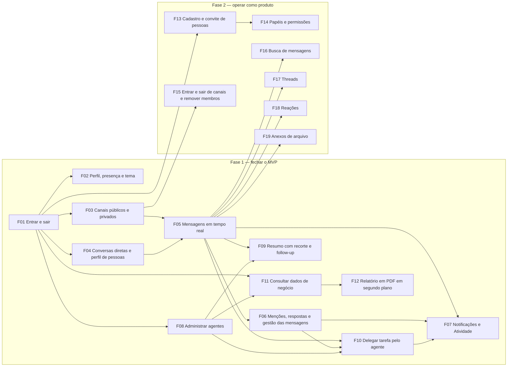

# Roadmap — Full Cycle Chat

Status: rascunho

Este documento é o dono da lista de funcionalidades, da ordem entre elas e do status de cada uma.
O escopo e o público estão no [product brief](product-brief.md); a arquitetura, no [HLD](hld.md) e
no [LLD](lld.md); o vocabulário, no [GLOSSARY.md](../GLOSSARY.md).

Cada funcionalidade é uma entrega demonstrável para quem usa o produto, não uma parte técnica. O
PRD e a spec de cada uma ficam em `docs/funcionalidades/<num-funcionalidade>-<titulo>/`, e as
tarefas, em `tarefas/`, seguindo a estrutura do `AGENTS.md` da raiz.

## Status

Os status são os do `AGENTS.md`:

**planejada** → **PRD pronto** → **spec pronta** → **em andamento** → **concluída**

"Planejada" é o estado inicial de toda funcionalidade listada aqui.

## Funcionalidades

| Func. | O que a pessoa consegue ao final | Fase | Depende de | Status | PRD | Spec |
| --- | --- | --- | --- | --- | --- | --- |
| F01 | Entrar com e-mail e senha criados pela empresa, manter a sessão no navegador e sair; a sessão revogada deixa de valer | 1 | — | em andamento | [PRD](funcionalidades/01-entrar-e-sair/prd.md) | [Spec](funcionalidades/01-entrar-e-sair/spec.md) |
| F02 | Editar o próprio nome, cargo, telefone, status e presença, e escolher o tema claro ou escuro | 1 | F01 | planejada | — | — |
| F03 | Conversar nos canais públicos do workspace e nos privados; criar um canal e convidar pessoas para um privado, que só quem foi convidado vê e usa | 1 | F01 | planejada | — | — |
| F04 | Buscar uma pessoa por nome ou @usuário, abrir uma conversa 1:1 com ela e ver o perfil de qualquer pessoa | 1 | F01 | planejada | — | — |
| F05 | Trocar mensagens nos canais e conversas diretas, vê-las chegar na hora, com aviso de digitando, histórico paginado, contagem de não lidas e recuperação do que se perdeu numa queda | 1 | F03, F04 | planejada | — | — |
| F06 | Mencionar pessoas, responder citando uma mensagem, copiar texto, editar e apagar as próprias mensagens, com a mudança aparecendo para todos na hora | 1 | F05 | planejada | — | — |
| F07 | Receber notificação de menção, conversa direta e tarefa, com alerta na tela e, se ligar, do navegador, clicando para ir direto à mensagem; reunir Menções, conversas diretas e Tarefas em Atividade | 1 | F05, F06, F10 | planejada | — | — |
| F08 | Como administrador, conectar e desconectar agentes do workspace; quem não administra vê os agentes disponíveis e a quem pedir | 1 | F01 | planejada | — | — |
| F09 | Pedir a um agente um resumo da conversa com recorte (hoje, desde ontem, a semana, tudo, o que uma pessoa disse, um assunto), responder à pergunta do agente sem mencioná-lo de novo e clicar nas respostas prontas | 1 | F05, F08 | planejada | — | — |
| F10 | Pedir ao agente para delegar uma tarefa a alguém mencionado; quem recebe é notificado, vê a tarefa em Atividade → Tarefas, conclui ou reabre, e quem delegou é avisado | 1 | F05, F06, F08 | planejada | — | — |
| F11 | Pedir ao agente contagens, somas e comparações de vendas em linguagem natural; só quem tem permissão de dados recebe o conteúdo, e os demais veem a resposta bloqueada | 1 | F01, F08 | planejada | — | — |
| F12 | Pedir um relatório em PDF e seguir conversando; o agente avisa que começou, entrega o arquivo na conversa quando termina e só quem tem permissão baixa o PDF | 1 | F11 | planejada | — | — |
| F13 | Criar contas e convidar pessoas para o workspace sem depender de script | 2 | F01 | planejada | — | — |
| F14 | Como administrador, definir quem é administrador e quem tem permissão de dados numa tela de papéis e permissões | 2 | F13 | planejada | — | — |
| F15 | Entrar e sair de canais e remover membros de um canal privado | 2 | F03 | planejada | — | — |
| F16 | Buscar mensagens no histórico | 2 | F05 | planejada | — | — |
| F17 | Responder a uma mensagem em thread | 2 | F05 | planejada | — | — |
| F18 | Reagir a mensagens | 2 | F05 | planejada | — | — |
| F19 | Enviar e baixar arquivos na conversa | 2 | F05 | planejada | — | — |

**Observação.** F01 tem o backend de login implementado na branch `feature/login`, o PRD aprovado
e a spec em rascunho, mas ainda sem plano de tarefa. Por isso entra como "em andamento"; as demais
começam em "planejada". A Fase 2 só começa quando a Fase 1 atingir as metas de qualidade: ≥ 98% na
avaliação, 0 número errado entregue, p95 ≤ 5 s e ≤ US$ 0,01 por pedido
([product brief](product-brief.md)).

## Mapa de dependências

## Decisões em aberto

As decisões abaixo vêm das questões em aberto do [product brief](product-brief.md) e travam o
planejamento de alguma funcionalidade ou fase:

| Decisão | Trava |
| --- | --- |
| Meta de uso do agente (% das pessoas ativas na semana com ao menos um pedido) | Avaliação da F09 à F12 |
| Meta de tarefas delegadas concluídas | Avaliação da F10 |
| Prazo das metas e o que conta como lançamento | Início da Fase 2 |
| Gráfico na conversa e relatório agendado entram no roadmap? | Lista de funcionalidades |
| Agente que age sem ser chamado entra no roadmap? | Lista de funcionalidades |

## Sem fase

Candidatos ainda sem número de funcionalidade, a decidir:

| Candidato | O que a pessoa consegue ao final | Depende de | Status |
| --- | --- | --- | --- |
| Gráfico na conversa | Ver um gráfico do resultado de uma consulta de dados de negócio dentro da conversa | F11 | a definir |
| Relatório agendado | Receber um relatório em PDF numa periodicidade definida | F12 | a definir |
| Agente que age sem ser chamado | Receber lembrete de tarefa parada e resumo automático do dia, sem mencionar o agente | F09, F10 | a definir |
